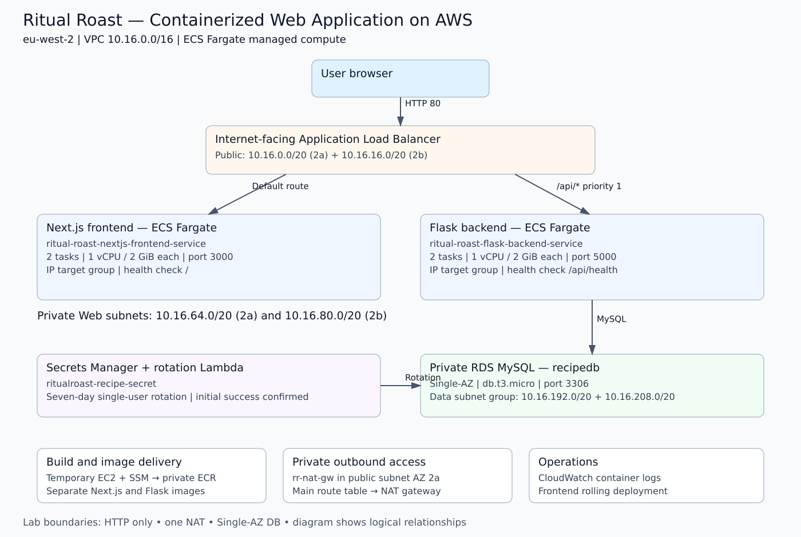

# 🍲 Ritual Roast — Containerized Web Application on AWS

> A cost-conscious AWS container deployment demonstrating ECS Fargate, Docker, ECR, path-based load balancing, private MySQL, secrets management, and rolling deployments.

**Region:** eu-west-2 (London)

**Status:** Deployment, application validation, frontend rolling update, and lab cleanup completed, as confirmed during the hands-on exercise. The live environment has been removed after practice.

## Project overview

This project modernizes the recipe contest application from Capstone 1 by separating the Next.js frontend and Flask backend into independently deployed Amazon ECS services on AWS Fargate. An internet-facing Application Load Balancer routes page requests to Next.js and `/api/*` requests to Flask. Recipe data is stored in private Amazon RDS MySQL, with credentials retrieved from AWS Secrets Manager.

The business objective was to reduce EC2 server administration for a small development team while allowing the frontend and backend to evolve independently. AWS manages the Fargate compute hosts; the application team remains responsible for container images, task sizing, permissions, deployment, and application behavior.

This was a console-led training implementation using course-provided application code. My work covered networking, IAM, image builds and publishing, ECS deployment, load balancing, secret rotation configuration, validation, a frontend release, and cleanup.

## Architecture

This is a logical diagram. Fargate compute is AWS-managed; each task has an ENI and private IP in the selected VPC subnet. The RDS subnet group spans two AZs, but the lab database itself is **Single-AZ**. The temporary EC2 instance is a build tool, not an application host.

### Request flow

1. A user opens the ALB address over HTTP.
2. The listener evaluates priority **1**: `/api/*` routes to the Flask target group on port **5000**.
3. Requests that do not match use the default action, routing to Next.js on port **3000**.
4. Flask retrieves connection details from Secrets Manager and reads/writes recipes in MySQL.
5. The browser displays the submitted recipe in the gallery; it remains visible after refresh.

## Implementation highlights

- Reused the existing VPC and configured private outbound access through one NAT gateway.
- Built separate Next.js and Flask Docker images on an SSM-accessible EC2 instance.
- Published the images to private ECR repositories with mutable `latest` tags and AES-256 encryption.
- Created two Fargate task definitions, each with **1 vCPU and 2 GiB memory**.
- Deployed **two tasks per service**, using both private web subnets and no public task IP addresses.
- Configured two IP target groups, ALB path routing, and application health checks.
- Enabled seven-day, single-user database credential rotation; initial rotation succeeded.
- Updated the frontend countdown, rebuilt/pushed its image, and forced a rolling deployment.
- Removed the lab environment after validation to control ongoing cost.

## Verified results

| Check | Result |
| --- | --- |
| Docker verification on build server | Passed |
| Initial database secret rotation | Passed |
| Frontend and backend service counts | 2/2 running tasks each |
| ALB target health | Two healthy IP targets per target group |
| Application homepage through ALB | Passed |
| Recipe submission and gallery display | Passed |
| Recipe persists after page refresh | Passed |
| Frontend rolling update and working countdown | Confirmed completed |
| Lab cleanup | Confirmed completed |

Results are based on the author's hands-on confirmations. Screenshot files and task-definition exports were not supplied with this documentation package. See the [evidence index](screenshots/README.md) for adding captured evidence.

## Repository structure

- `README.md` — project introduction and outcomes
- `BUILD_TRACKER.md` — completed implementation phases
- `PROJECT_SUMMARY.md` — portfolio summary
- `TECHNICAL_OVERVIEW.md` — component configuration
- `INTERVIEW_GUIDE.md` — project discussion questions
- `architecture/` — diagram and architecture decisions
- `docs/` — numbered implementation documentation
- `policies/` — scoped IAM policy example
- `screenshots/` — grouped evidence folders
- `source-reference/` — application source attribution

## Documentation

| Document | Purpose |
| --- | --- |
| [Project Summary](PROJECT_SUMMARY.md) | Portfolio overview |
| [Technical Overview](TECHNICAL_OVERVIEW.md) | Resource names and component configuration |
| [Build Tracker](BUILD_TRACKER.md) | Implementation progress |
| [Architecture](architecture/README.md) | Diagram, traffic flow and decisions |
| [Project Requirements](docs/01-project-requirements.md) | Business and technical scope |
| [Network Design](docs/02-network-design.md) | CIDRs, routes and subnet placement |
| [Security Design](docs/03-security-design.md) | IAM, security groups and secret rotation |
| [Deployment Process](docs/04-deployment-process.md) | Manual deployment and rolling release |
| [Validation](docs/05-validation.md) | Confirmed functional and service results |
| [Troubleshooting](docs/06-troubleshooting.md) | Diagnostic reference |
| [Cost Considerations](docs/07-cost-considerations.md) | Cost drivers and lab tradeoffs |
| [Cleanup Guide](docs/08-cleanup.md) | Dependency-aware teardown |
| [Lessons Learned](docs/09-lessons-learned.md) | Engineering conclusions and improvements |
| [Interview Guide](INTERVIEW_GUIDE.md) | Technical discussion and review |
| [Screenshot Index](screenshots/README.md) | Capture list and folder mapping |
| [Source Reference](source-reference/README.md) | Upstream source and author contributions |

## Design tradeoffs

| Lab choice | Implication / production improvement |
| --- | --- |
| Fargate services | Independent deployment; configure service scaling policies when required |
| Shared application security group | Simple lab configuration; separate frontend and backend SGs to restrict DB access to Flask |
| Single-AZ MySQL | Lower practice cost; use Multi-AZ where database availability requires it |
| One NAT gateway in AZ 2a | Shared outbound dependency; consider per-AZ NAT gateways or suitable VPC endpoints |
| HTTP listener | Training traffic only; use HTTPS with ACM for a public production application |
| Mutable `latest` tag | Convenient exercise release; use version tags/digests for traceable releases |
| Manual console deployment | Hands-on learning; infrastructure as code and CI/CD are future improvements |

Multi-AZ failover, load testing, automatic scaling policies, task-failure recovery testing, and application credential refresh after rotation are **not claimed as tested**. Configuring successful secret rotation alone does not prove that a running application refreshes cached credentials.

## Skills demonstrated

Amazon VPC networking, security groups, IAM roles, Systems Manager, Docker, ECR, ECS/Fargate, ALB path routing, RDS MySQL, Secrets Manager rotation, CloudWatch log configuration, rolling deployments, and resource cleanup.

## Acknowledgments

Based on IaaS Academy's AWS Solutions Architect Associate Capstone Project 2. Thanks to **IaaS Academy and Rajesh** for the guided project and application resources. [Original course source](https://github.com/iaasacademy/aws-solutions-architect-associate/tree/main/section11).
