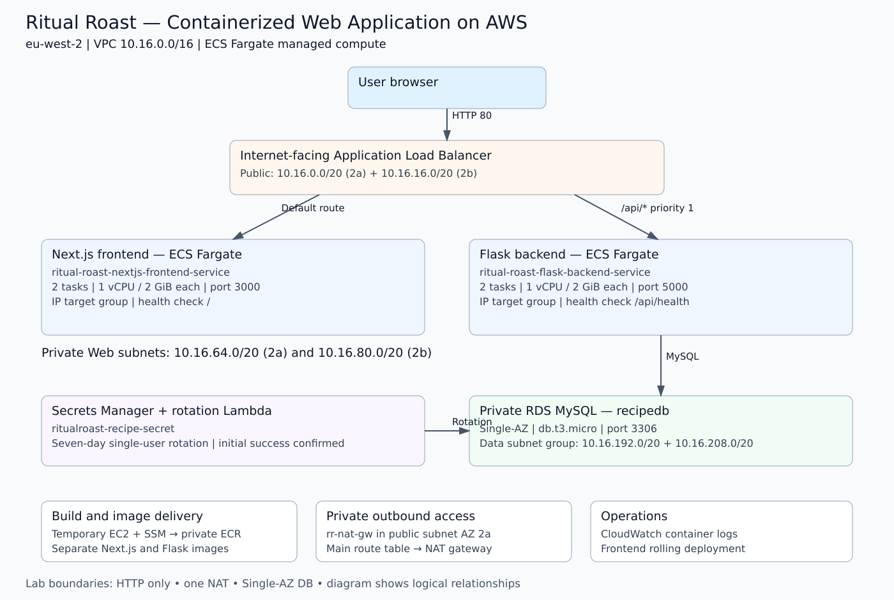
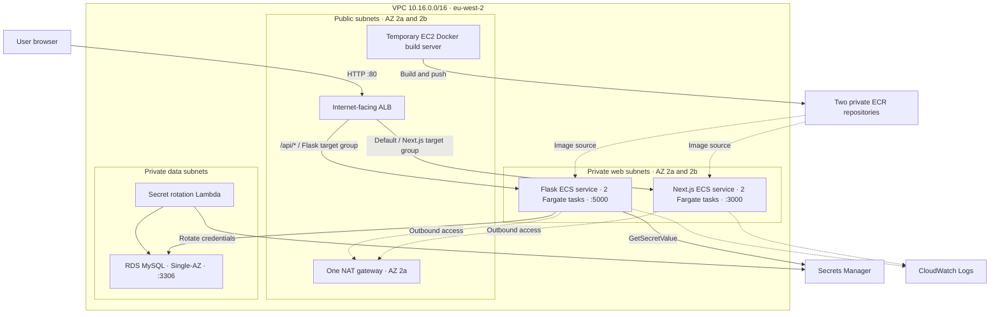

# Architecture Design

## Overview

Separate Next.js and Flask ECS services run on Fargate with two tasks each. The ALB routes by path to IP target groups. RDS and application tasks remain private; Secrets Manager supplies credentials and a VPC-connected Lambda performs rotation.

## Request flow

## Availability boundaries

The ALB uses two public subnets. Services are configured with two private web subnets. The lab uses Single-AZ MySQL and a single NAT gateway. The subnet group spans two AZs but does not make the database Multi-AZ. A cluster is a logical service/task grouping rather than an independent network security boundary.

## Architecture decisions

- [ADR-001: Separate Fargate services](decisions/001-separate-fargate-services.md)
- [ADR-002: ALB path routing](decisions/002-alb-path-routing.md)
- [ADR-003: Single-AZ RDS](decisions/003-single-az-rds.md)
- [ADR-004: Single NAT gateway](decisions/004-single-nat-gateway.md)

See [Network Design](../docs/02-network-design.md), [Security Design](../docs/03-security-design.md), and [Technical Overview](../TECHNICAL_OVERVIEW.md).
