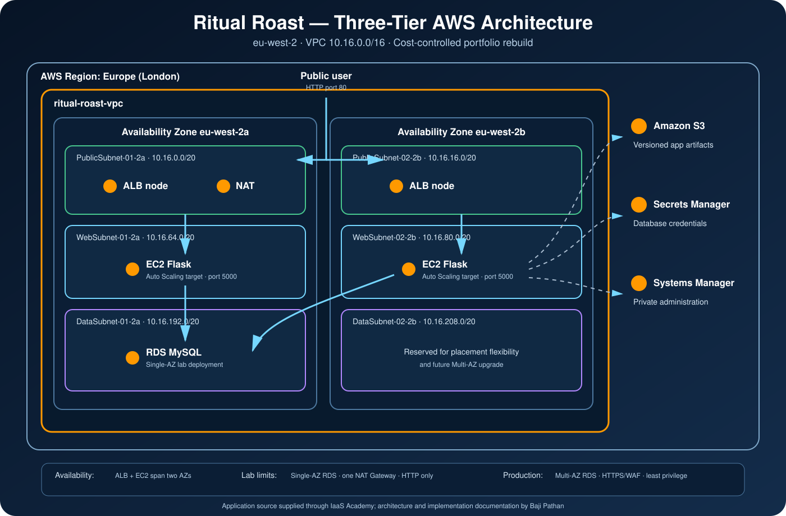

# 🍲 Ritual Roast — Three-Tier Web Application on AWS

> A cost-conscious three-tier AWS deployment demonstrating VPC networking, private EC2 application servers, load balancing, Auto Scaling, managed MySQL, secrets management, troubleshooting, and operational documentation.

---

## Project overview

Ritual Roast is a recipe-contest application completed as an IaaS Academy capstone. A visitor opens the application through an internet-facing Application Load Balancer, submits a recipe, and views recipes stored in Amazon RDS for MySQL.

The rebuild deliberately separates the public, application, and data tiers. EC2 instances run in private subnets, are created by an Auto Scaling group, retrieve application artifacts from Amazon S3, and obtain database credentials from AWS Secrets Manager.

The original capstone called for RDS Multi-AZ. This cost-controlled rebuild uses a free-tier-eligible Single-AZ database; Multi-AZ remains the recommended production configuration.

## What this project demonstrates

- VPC and subnet planning across two Availability Zones
- Public and private routing through an Internet Gateway and NAT Gateway
- Security-group references between application tiers
- An internet-facing Application Load Balancer and health-checked target group
- Repeatable EC2 provisioning with a launch template and user data
- An Auto Scaling group maintaining two private application instances
- Private RDS MySQL connectivity
- Database credentials stored in AWS Secrets Manager
- Session Manager access without public SSH
- S3-based application artifact delivery and versioning
- Troubleshooting an unhealthy target caused by an incorrect secret name

## Solution architecture

<p align="center">
  
</p>

### Request flow

1. A user sends an HTTP request to the Application Load Balancer.
2. The ALB forwards the request to a healthy Flask target on port `5000`.
3. The application retrieves database credentials from Secrets Manager.
4. The application connects to RDS MySQL on port `3306`.
5. Recipe data is stored or retrieved and returned to the user through the ALB.

## AWS services used

| AWS service | Purpose |
|---|---|
| Amazon VPC | Network isolation and subnet segmentation |
| Elastic Load Balancing | Public entry point and health-based request distribution |
| Amazon EC2 | Runs the Flask application |
| EC2 Auto Scaling | Maintains two application instances across two AZs |
| Amazon RDS for MySQL | Stores recipe data |
| Amazon S3 | Stores versioned application artifacts |
| AWS Secrets Manager | Stores and rotates database credentials |
| AWS Systems Manager | Provides administrative access without SSH |
| AWS IAM | Grants EC2 access to S3, Secrets Manager, and Systems Manager |

## Network design

| Tier | Availability Zone | Subnet | CIDR |
|---|---|---|---|
| Public | `eu-west-2a` | `PublicSubnet-01-2a` | `10.16.0.0/20` |
| Public | `eu-west-2b` | `PublicSubnet-02-2b` | `10.16.16.0/20` |
| Application | `eu-west-2a` | `WebSubnet-01-2a` | `10.16.64.0/20` |
| Application | `eu-west-2b` | `WebSubnet-02-2b` | `10.16.80.0/20` |
| Data | `eu-west-2a` | `DataSubnet-01-2a` | `10.16.192.0/20` |
| Data | `eu-west-2b` | `DataSubnet-02-2b` | `10.16.208.0/20` |

The two public subnets explicitly use `ritual-roast-public-rt`. The Web and Data subnets implicitly use `ritual-roast-main-rt`, which routes outbound traffic through the single lab NAT Gateway.

## Security flow

| Source | Destination | Port | Purpose |
|---|---|---:|---|
| Internet | ALB security group | `80` | Public HTTP access |
| ALB security group | Web security group | `5000` | Flask application traffic |
| Web security group | Database security group | `3306` | MySQL traffic |
| Database security group | Itself | `3306` | Secret-rotation Lambda connectivity |

The EC2 instances and database are not publicly accessible. Session Manager replaces inbound SSH access.

## Availability and limitations

| Area | Implemented | Limitation or production improvement |
|---|---|---|
| Load balancing | ALB across two public subnets | Add HTTPS and AWS WAF |
| Application | Two EC2 instances across two AZs | Add dynamic scaling and a production WSGI server |
| Database | Single-AZ RDS MySQL | Convert to Multi-AZ for automatic failover |
| Outbound network | One NAT Gateway | Use one NAT Gateway per AZ |
| Private routing | Web and Data subnets share the main route table | Give the Data tier a local-only route table |
| S3 permissions | `AmazonS3FullAccess` used by the guided lab | Replace with bucket-scoped read access |

## Validation status

Completed validation:

- The ALB DNS name opened the application.
- Both EC2 targets reached `Healthy` status.
- A recipe was submitted and retrieved from MySQL.
- The application instances appeared as Systems Manager managed nodes.
- An incorrect Secrets Manager name was diagnosed and corrected.

Pending before final closure:

- Stop one EC2 instance and capture Auto Scaling replacement evidence.
- Verify continued application availability during replacement.
- Delete all chargeable resources and confirm cleanup.

## Troubleshooting highlight

The initial targets remained unhealthy because `ritual-roast.py` referenced the wrong Secrets Manager secret name. Inspection of the EC2 bootstrap and Flask logs isolated the dependency failure. After correcting the secret name, uploading a new version to S3, and replacing the instances, the targets became healthy and the end-to-end application worked.

See [Troubleshooting](docs/06-troubleshooting.md) for the diagnostic workflow.

## Repository structure

```text
aws-three-tier-web-application/
├── README.md
├── BUILD_TRACKER.md
├── PROJECT_SUMMARY.md
├── TECHNICAL_OVERVIEW.md
├── INTERVIEW_GUIDE.md
├── architecture/
│   ├── README.md
│   ├── decisions/
│   └── images/
├── docs/
├── policies/
├── screenshots/
└── source-reference/
```

## Documentation

| Document | Purpose |
|---|---|
| [Project Summary](PROJECT_SUMMARY.md) | Concise portfolio and interview overview |
| [Technical Overview](TECHNICAL_OVERVIEW.md) | Detailed component and traffic-flow design |
| [Architecture](architecture/README.md) | Network, security, availability, and design decisions |
| [Project Requirements](docs/01-project-requirements.md) | Business, functional, and technical requirements |
| [Network Design](docs/02-network-design.md) | CIDRs, route tables, and connectivity |
| [Security Design](docs/03-security-design.md) | Security groups, IAM, and secrets |
| [Deployment Process](docs/04-deployment-process.md) | Ordered manual deployment guide |
| [Validation](docs/05-validation.md) | Functional and infrastructure checks |
| [Troubleshooting](docs/06-troubleshooting.md) | Observed issue and diagnostic commands |
| [Cost Considerations](docs/07-cost-considerations.md) | Lab cost decisions and trade-offs |
| [Cleanup Guide](docs/08-cleanup.md) | Safe dependency-aware teardown |
| [Lessons Learned](docs/09-lessons-learned.md) | Engineering conclusions and improvements |
| [Interview Guide](INTERVIEW_GUIDE.md) | Project discussion and review questions |

## Project status

**Status:** Functional deployment validated; EC2 recovery evidence and final cleanup remain pending.

## Attribution

This project was completed as part of the IaaS Academy training program. The project scenario and application source code were supplied through the course. The AWS deployment, configuration, testing, troubleshooting, architectural analysis, and portfolio documentation reflect my hands-on implementation and learning.

The course-provided application code and proprietary course materials are not redistributed in this repository.

## Continue exploring

- [AWS Cloud Engineering Portfolio](../README.md)
- [Architecture details](architecture/README.md)
- [Interview guide](INTERVIEW_GUIDE.md)

