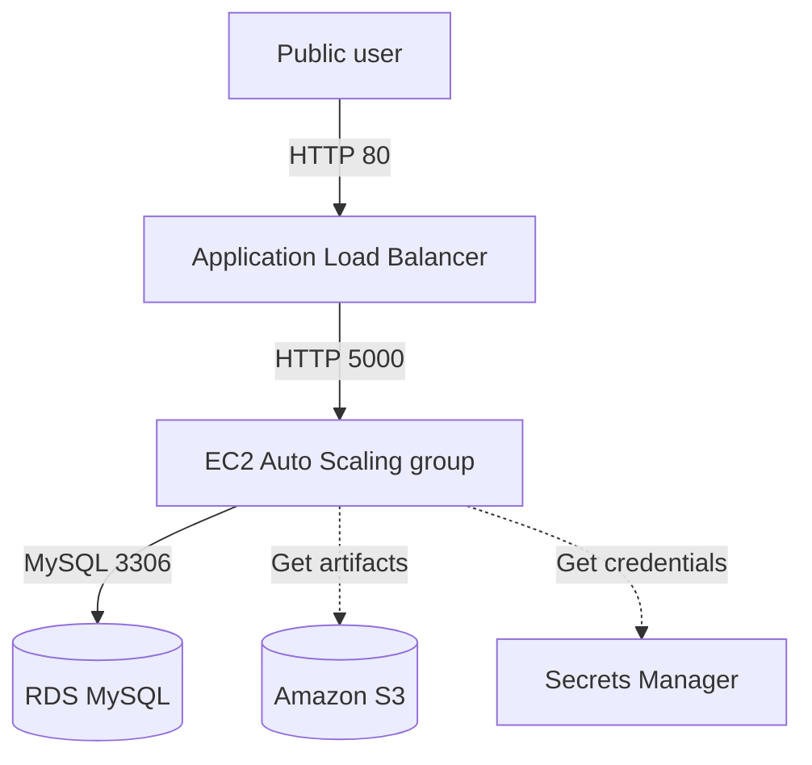

# Architecture Design

## Overview

Ritual Roast uses a three-tier design in `eu-west-2`. The public ALB spans two Availability Zones, the Flask application runs on two private EC2 instances, and a private Single-AZ RDS MySQL instance stores recipes.

## Request flow

## Network placement

| Component | Placement | Publicly accessible |
|---|---|---|
| ALB | Public subnets in `eu-west-2a` and `eu-west-2b` | Yes |
| NAT Gateway | `PublicSubnet-01-2a` | No inbound access |
| EC2 instances | Private Web subnets in two AZs | No |
| RDS MySQL | Private Data subnet | No |
| S3, Secrets Manager, Systems Manager | Regional services | No public resource access |

## Routing

| Route table | Subnets | Default route |
|---|---|---|
| `ritual-roast-public-rt` | Two explicit Public-subnet associations | Internet Gateway |
| `ritual-roast-main-rt` | Web and Data subnets implicitly | NAT Gateway |

The shared private route table reflects the guided implementation. A production Data tier would use a separate local-only route table.

## Security boundaries

| Source | Destination | Port |
|---|---|---:|
| Internet | `ritual-roast-alb-sg` | `80` |
| `ritual-roast-alb-sg` | `ritual-roast-web-sg` | `5000` |
| `ritual-roast-web-sg` | `ritual-roast-db-sg` | `3306` |
| `ritual-roast-db-sg` | Itself | `3306` |

## Supporting services

- `rr-capstone-source-code-025` stores versioned application artifacts with public access blocked.
- `ritual-roast-rds-db-secret` stores database credentials and has seven-day rotation configured.
- `ritual-roast-master-ec2-iam-role` gives EC2 access to Systems Manager, S3, and the database secret.
- Session Manager provides administrative access without public IPs or inbound SSH.

## Availability design

The load balancer and EC2 application tier span two AZs. The Auto Scaling group maintains two instances and can replace unhealthy capacity. The database is Single-AZ and the NAT Gateway is located only in `eu-west-2a`; these are documented lab limitations rather than hidden production claims.

## Architecture decisions

- [ADR-001: Two-AZ segmented VPC](decisions/001-two-az-segmented-vpc.md)
- [ADR-002: Private EC2 with Session Manager](decisions/002-private-ec2-session-manager.md)
- [ADR-003: Cost-controlled Single-AZ RDS](decisions/003-single-az-rds.md)
- [ADR-004: Single NAT Gateway for the lab](decisions/004-single-nat-gateway.md)

