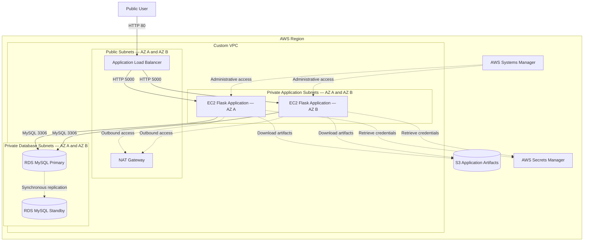

# Architecture Design

## Architecture Overview

This project deploys a highly available three-tier recipe application across two AWS Availability Zones.

The three logical tiers are:

1. **Web tier:** Internet-facing Application Load Balancer
2. **Application tier:** Flask application running on EC2 instances managed by an Auto Scaling group
3. **Database tier:** Amazon RDS for MySQL configured with Multi-AZ availability

## Architecture Diagram

> This Mermaid diagram provides a documentation-friendly representation of the architecture. A detailed AWS architecture diagram using official AWS icons will be added after the final resource design is confirmed.

## Request Flow

1. A user opens the Application Load Balancer DNS name.
2. The Application Load Balancer receives an HTTP request on port `80`.
3. The load balancer forwards the request to a healthy EC2 target on port `5000`.
4. The Flask application processes the request.
5. The application retrieves the database credentials from AWS Secrets Manager.
6. The application connects to Amazon RDS for MySQL on port `3306`.
7. The database stores or retrieves the recipe information.
8. The response returns through the application and load balancer to the user.

## Network Placement

| Component | Network placement | Publicly accessible |
|---|---|---|
| Application Load Balancer | Public subnets across two Availability Zones | Yes |
| NAT Gateway | Public subnet | No inbound user access |
| EC2 application instances | Private application subnets across two Availability Zones | No |
| RDS MySQL primary and standby | Private database subnets across two Availability Zones | No |
| Amazon S3 | Regional AWS service outside the VPC | No public access |
| AWS Secrets Manager | Regional AWS service outside the VPC | No public access |
| AWS Systems Manager | Regional AWS service outside the VPC | No public access |

## Security Group Flow

| Source | Destination | Protocol and port | Purpose |
|---|---|---|---|
| Internet | ALB security group | TCP `80` | Access the web application |
| ALB security group | Application security group | TCP `5000` | Forward requests to Flask |
| Application security group | Database security group | TCP `3306` | Connect to MySQL |

The database does not accept traffic directly from the internet or the Application Load Balancer.

## Availability Design

### Application tier

The Auto Scaling group maintains application instances across two Availability Zones. The Application Load Balancer sends traffic only to healthy registered targets.

If an application instance becomes unhealthy, the Auto Scaling group terminates it and launches a replacement.

### Database tier

Amazon RDS for MySQL uses a Multi-AZ deployment. AWS maintains a synchronously replicated standby database in another Availability Zone.

During a qualifying database or Availability Zone failure, Amazon RDS can fail over to the standby instance while retaining the database endpoint.

### Learning-environment limitation

The learning implementation uses one NAT Gateway to control practice costs. This creates an Availability Zone dependency for outbound connectivity from the private application subnets.

A production implementation would normally use one NAT Gateway in each Availability Zone.

## Supporting AWS Services

### Amazon S3

Amazon S3 stores the application deployment artifacts. EC2 instances download the required files during initialization.

Bucket versioning is enabled to preserve previous versions of application files.

### AWS Secrets Manager

AWS Secrets Manager stores the database credentials so they do not need to be hard-coded in the application or EC2 user-data script.

### AWS Systems Manager

AWS Systems Manager Session Manager provides administrative access to the private EC2 instances without exposing SSH access to the internet.

### AWS Identity and Access Management

An IAM role attached to the EC2 instances provides permission to:

- Connect to Systems Manager
- Download application artifacts from the designated S3 bucket
- Retrieve the required database secret from Secrets Manager

The permissions should be restricted to the specific resources required by the application.

## Architecture Decisions

| Decision | Learning implementation | Production consideration |
|---|---|---|
| Availability Zones | Two | Continue using two or more AZs |
| Application compute | EC2 Auto Scaling group | Appropriate, although containers could also be evaluated |
| Database | RDS MySQL Multi-AZ | Appropriate for high availability |
| NAT Gateway | One NAT Gateway | Use one per Availability Zone |
| Client protocol | HTTP | Use HTTPS with AWS Certificate Manager |
| Flask server | Development server on port `5000` | Use Gunicorn or another production WSGI server |
| Administrative access | Systems Manager Session Manager | Recommended |
| Database credentials | Secrets Manager | Recommended |
| Application artifacts | Versioned S3 bucket | Add deployment controls and artifact integrity checks |

## Planned Production Improvements

- Configure HTTPS using AWS Certificate Manager
- Redirect HTTP requests to HTTPS
- Add AWS WAF protection
- Deploy one NAT Gateway per Availability Zone
- Add VPC endpoints for S3, Secrets Manager and Systems Manager
- Run Flask behind a production WSGI server such as Gunicorn
- Implement a dedicated application health-check endpoint
- Collect application and operating-system logs in CloudWatch
- Configure CloudWatch dashboards and alarms
- Apply resource-specific IAM and S3 policies
- Encrypt sensitive resources with appropriate KMS keys
- Automate infrastructure provisioning with Terraform