# Architecture Design

## 1. Architecture Overview

Ritual Roast is a highly available three-tier recipe-submission application deployed on AWS.

Members of the public access the application through an internet-facing Application Load Balancer. The load balancer distributes requests across Flask application servers managed by an EC2 Auto Scaling group. Recipe information is stored in an Amazon RDS for MySQL Multi-AZ database.

The solution is deployed in the AWS London Region across two Availability Zones.

## 2. Three-Tier Architecture

The architecture contains three logical tiers:

1. **Web tier:** Internet-facing Application Load Balancer
2. **Application tier:** Flask application running on EC2 instances
3. **Database tier:** Amazon RDS for MySQL Multi-AZ deployment

Supporting AWS services provide source-code storage, credentials management and administrative access.

## 3. Architecture Diagram

```mermaid
flowchart TB
    User["Public User"]

    subgraph Region["AWS Region — eu-west-2"]
        subgraph VPC["ritual-roast-vpc — 10.16.0.0/16"]
            subgraph Public["Public Subnets — Two Availability Zones"]
                ALB["Application Load Balancer"]
                NAT["NAT Gateway"]
            end

            subgraph Application["Private Web Subnets — Two Availability Zones"]
                ASG["EC2 Auto Scaling Group"]
            end

            subgraph Database["Private Data Subnets — Two Availability Zones"]
                RDS[("RDS MySQL Multi-AZ")]
            end
        end

        S3[("S3 Application Artifacts")]
        Secrets["AWS Secrets Manager"]
        SSM["AWS Systems Manager"]
    end

    User -->|"HTTP 80"| ALB
    ALB -->|"HTTP 5000"| ASG
    ASG -->|"MySQL 3306"| RDS

    ASG -.->|"Download application files"| S3
    ASG -.->|"Retrieve database credentials"| Secrets
    SSM -.->|"Administrative access"| ASG
    ASG -.->|"Outbound connectivity"| NAT
```



> This Mermaid diagram provides a documentation-friendly view of the solution. A detailed architecture diagram using official AWS service icons can be added after the deployment is complete.

## 4. Request Flow

1. A user opens the Application Load Balancer DNS name.
2. The Application Load Balancer receives the request on HTTP port `80`.
3. The load balancer selects a healthy EC2 target.
4. The request is forwarded to the Flask application on port `5000`.
5. The application retrieves the database credentials from AWS Secrets Manager.
6. The application connects to Amazon RDS for MySQL on port `3306`.
7. The database stores or retrieves the recipe information.
8. The application returns the response through the load balancer.
9. The user receives either a confirmation message or the recipe-gallery page.

## 5. Regional Design

| Setting | Value |
|---|---|
| AWS Region | Europe (London) |
| Region code | `eu-west-2` |
| Availability Zone 1 | `eu-west-2a` |
| Availability Zone 2 | `eu-west-2b` |
| VPC | `ritual-roast-vpc` |
| VPC CIDR | `10.16.0.0/16` |
| DNS resolution | Enabled |
| DNS hostnames | Enabled |

> Availability Zone names can map to different physical facilities in different AWS accounts.

## 6. Subnet Design

| Subnet | Availability Zone | CIDR | Tier | Primary use |
|---|---|---|---|---|
| `PublicSubnet-01-2a` | `eu-west-2a` | `10.16.0.0/20` | Public | ALB node and NAT Gateway |
| `PublicSubnet-02-2b` | `eu-west-2b` | `10.16.16.0/20` | Public | ALB node |
| `WebSubnet-01-2a` | `eu-west-2a` | `10.16.64.0/20` | Private | EC2 application instances |
| `WebSubnet-02-2b` | `eu-west-2b` | `10.16.80.0/20` | Private | EC2 application instances |
| `DataSubnet-01-2a` | `eu-west-2a` | `10.16.192.0/20` | Private | RDS primary or standby |
| `DataSubnet-02-2b` | `eu-west-2b` | `10.16.208.0/20` | Private | RDS primary or standby |

Each `/20` subnet contains 4,096 IP addresses. AWS reserves five addresses in each subnet, leaving 4,091 usable addresses.

The primary and standby RDS roles are not permanently tied to particular subnets. Their roles can change during a Multi-AZ failover.

## 7. Network Placement

| Component | Network placement | Publicly accessible |
|---|---|---|
| Application Load Balancer | Public subnets across two Availability Zones | Yes |
| NAT Gateway | `PublicSubnet-01-2a` | No inbound user access |
| EC2 application instances | Private Web subnets across two Availability Zones | No |
| RDS MySQL deployment | Private Data subnets across two Availability Zones | No |
| Amazon S3 | Regional AWS service outside the VPC | No public access |
| AWS Secrets Manager | Regional AWS service outside the VPC | No public access |
| AWS Systems Manager | Regional AWS service outside the VPC | No public access |

## 8. Internet Connectivity

### Internet Gateway

The following Internet Gateway is attached to the VPC:

```text
ritual-roast-igw
```

It provides internet connectivity to resources that use the public route table.

### NAT Gateway

The following public NAT Gateway is deployed in `PublicSubnet-01-2a`:

```text
ritual-roast-ngw
```

It uses this Elastic IP resource:

```text
ritual-roast-eip
```

The NAT Gateway provides outbound connectivity for private resources without allowing the internet to initiate connections to them.

One NAT Gateway is used to control the cost of the practice environment. A production design would normally use one NAT Gateway per Availability Zone.

## 9. Route Table Design

### Public route table

The following route table is explicitly associated with the two public subnets:

```text
ritual-roast-public-rt
```

| Destination | Target |
|---|---|
| `10.16.0.0/16` | Local |
| `0.0.0.0/0` | `ritual-roast-igw` |

Explicit subnet associations:

- `PublicSubnet-01-2a`
- `PublicSubnet-02-2b`

### Main route table

The VPC main route table is:

```text
ritual-roast-main-rt
```

| Destination | Target |
|---|---|
| `10.16.0.0/16` | Local |
| `0.0.0.0/0` | `ritual-roast-ngw` |

The Web and Data subnets are not explicitly associated with a route table. They use `ritual-roast-main-rt` implicitly because it is the VPC main route table.

Subnets using the main route table implicitly:

- `WebSubnet-01-2a`
- `WebSubnet-02-2b`
- `DataSubnet-01-2a`
- `DataSubnet-02-2b`

A stronger production design would use separate route tables for the application and database subnets. The database route table would normally contain only the local VPC route.

## 10. Security Group Design

| Security group | Inbound rule | Source | Purpose |
|---|---|---|---|
| `ritual-roast-alb-sg` | TCP `80` | `0.0.0.0/0` | Allows public HTTP traffic |
| `ritual-roast-web-sg` | TCP `5000` | `ritual-roast-alb-sg` | Allows ALB requests to Flask |
| `ritual-roast-db-sg` | TCP `3306` | `ritual-roast-web-sg` | Allows application access to MySQL |

The database does not accept connections directly from the internet or from the Application Load Balancer.

The EC2 instances do not require an inbound SSH rule because administrative access uses AWS Systems Manager Session Manager.

## 11. IAM Design

The EC2 application instances use the following IAM role:

```text
ritual-roast-master-ec2-iam-role
```

The role trusts the Amazon EC2 service and includes the permissions required by the application instances.

| Policy | Policy type | Purpose |
|---|---|---|
| `AmazonSSMManagedInstanceCore` | AWS managed | Enables Systems Manager and Session Manager access |
| `AmazonS3FullAccess` | AWS managed | Allows access to application artifacts stored in Amazon S3 |
| `ritual-roast-rds-db-secret-policy` | Custom policy | Allows retrieval of the RDS database secret |

Only one IAM role is attached to the EC2 instance profile. The role combines all permissions required by the instance.

### IAM security observation

`AmazonS3FullAccess` was used as part of the guided learning implementation. It grants broader permissions than the application requires.

A production implementation should replace it with a least-privilege policy that permits only:

- `s3:ListBucket` for the application-artifact bucket
- `s3:GetObject` for objects in that bucket

The Secrets Manager policy should permit `secretsmanager:GetSecretValue` only for the Ritual Roast database secret.

## 12. Application Load Balancer

The Application Load Balancer:

- Is internet-facing
- Runs across both public subnets
- Listens for HTTP traffic on port `80`
- Uses `ritual-roast-alb-sg`
- Sends traffic to an EC2 target group
- Forwards requests to application port `5000`
- Sends requests only to healthy targets

The ALB DNS name serves as the public application endpoint.

## 13. EC2 Auto Scaling

The EC2 application tier uses:

- An EC2 launch template
- A user-data initialization script
- An Auto Scaling group
- Two private Web subnets
- An Application Load Balancer target group

The Auto Scaling group maintains the required number of EC2 instances and registers them with the target group.

If an application instance becomes unhealthy, the Auto Scaling group launches a replacement.

## 14. Amazon RDS for MySQL

The database tier uses Amazon RDS for MySQL in a Multi-AZ configuration.

The RDS deployment:

- Uses `ritual-roast-rds-subnet-group`
- Uses both private Data subnets
- Is not publicly accessible
- Uses `ritual-roast-db-sg`
- Accepts MySQL traffic on port `3306` only from the Web security group
- Maintains a synchronous standby in another Availability Zone
- Uses a stable database endpoint during failover

## 15. Amazon S3

Amazon S3 stores the application source files used to initialize the EC2 instances.

```text
rr-capstone-source-code-025
```

The S3 bucket:

- Is created in `eu-west-2`
- Uses versioning
- Blocks public access
- Stores the Flask application artifacts
- Is accessed by the EC2 IAM role

The EC2 initialization process downloads the required application files from the bucket.

## 16. AWS Secrets Manager

AWS Secrets Manager stores the RDS database credentials.

The application retrieves the secret at runtime using the permission granted by:

```text
ritual-roast-rds-db-secret-policy
```

Database credentials are not stored directly in:

- Application source code
- EC2 user data
- GitHub documentation
- Public screenshots

## 17. AWS Systems Manager

AWS Systems Manager Session Manager provides administrative access to the private EC2 instances.

This removes the need for:

- Public EC2 IP addresses
- An inbound SSH rule
- A bastion host for this implementation
- Distribution of SSH private keys

The EC2 instances use the NAT Gateway to reach the required Systems Manager endpoints.

## 18. High-Availability Design

### Load-balancing tier

The Application Load Balancer operates across two public subnets in separate Availability Zones.

### Application tier

The Auto Scaling group places EC2 instances across both private Web subnets. Traffic is sent only to targets that pass the configured health checks.

If an instance is stopped or becomes unhealthy, Auto Scaling replaces it.

### Database tier

Amazon RDS for MySQL uses a Multi-AZ deployment with a synchronously replicated standby in another Availability Zone.

During a qualifying failure or user-initiated failover, the standby can be promoted to become the new primary.

## 19. Architecture Decisions

| Decision | Learning implementation | Production consideration |
|---|---|---|
| AWS Region | `eu-west-2` | Select based on business, compliance and latency requirements |
| Availability Zones | Two | Use two or more based on resilience requirements |
| Public entry point | Application Load Balancer | Appropriate |
| Application compute | EC2 Auto Scaling | Appropriate; containers could also be evaluated |
| Database | RDS MySQL Multi-AZ | Appropriate for managed relational availability |
| NAT Gateway | One | Use one per Availability Zone |
| Private routing | Web and Data subnets share main route table | Use separate route tables |
| Client protocol | HTTP on port `80` | Use HTTPS with ACM |
| Flask server | Application port `5000` | Run behind a production WSGI server |
| Administrative access | Systems Manager | Retain |
| Database credentials | Secrets Manager | Retain and configure rotation |
| S3 access | `AmazonS3FullAccess` | Restrict access to the application bucket |
| Application artifacts | Versioned S3 bucket | Add controlled build and release processes |

## 20. Planned Production Improvements

- Configure HTTPS using AWS Certificate Manager
- Redirect HTTP traffic to HTTPS
- Add AWS WAF protection
- Use one NAT Gateway per Availability Zone
- Create separate route tables for Web and Data subnets
- Remove the default route from the database route table
- Add an S3 gateway VPC endpoint
- Add interface endpoints for Systems Manager and Secrets Manager
- Replace `AmazonS3FullAccess` with least-privilege S3 permissions
- Run Flask using Gunicorn or another production WSGI server
- Implement a dedicated application health endpoint
- Add CloudWatch logs, dashboards and alarms
- Enable VPC Flow Logs
- Encrypt sensitive resources using appropriate KMS keys
- Automate infrastructure provisioning with Terraform

## 21. Detailed Documentation

- [Project Requirements](../docs/01-project-requirements.md)
- [Network Design](../docs/02-network-design.md)
- [Security Design](../docs/03-security-design.md)