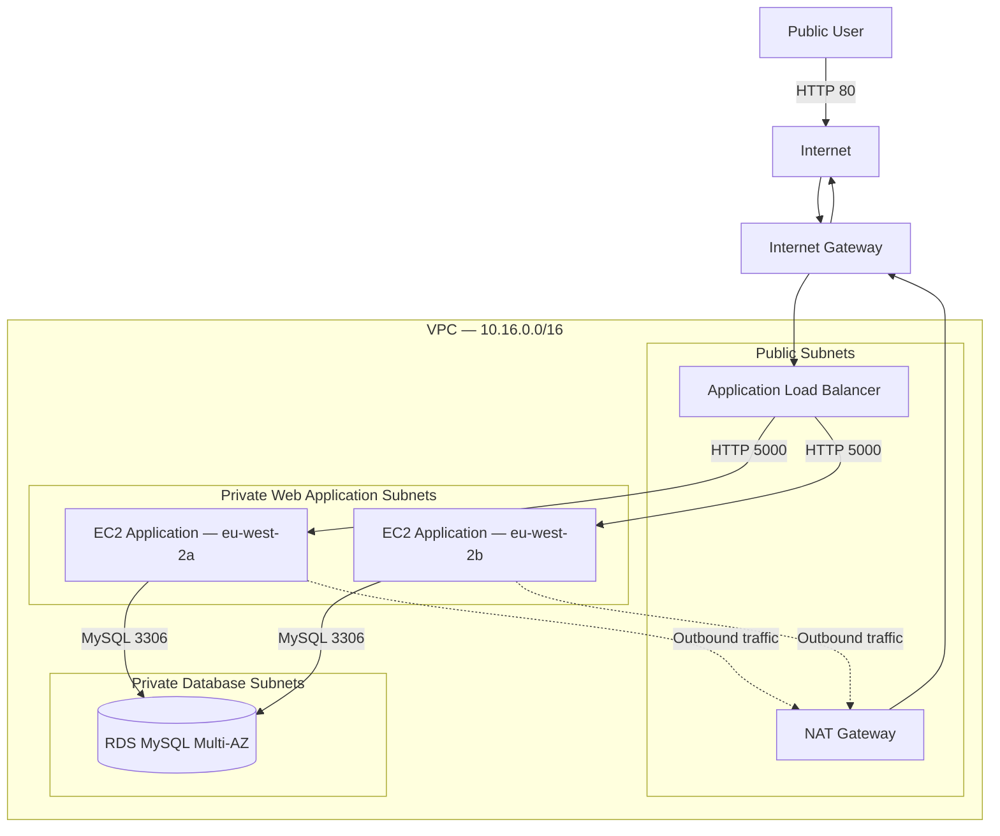

# Network Design

## 1. Overview

The recipe application is deployed inside a custom Amazon VPC in the AWS London Region.

The network spans two Availability Zones and separates the load-balancing, application and database resources across three subnet tiers:

1. Public subnets
2. Private web application subnets
3. Private database subnets

The implementation uses a public route table for the public subnets and the VPC main route table for the private web application and database subnets.

## 2. Regional Configuration

| Setting | Value |
|---|---|
| AWS Region | Europe (London) |
| Region code | `eu-west-2` |
| Availability Zone 1 | `eu-west-2a` |
| Availability Zone 2 | `eu-west-2b` |
| VPC CIDR | `10.16.0.0/16` |
| DNS resolution | Enabled |
| DNS hostnames | Enabled |

> Availability Zone names such as `eu-west-2a` can map to different physical facilities in different AWS accounts.

## 3. Subnet Plan

| Subnet | Availability Zone | CIDR | Tier | Resources |
|---|---|---|---|---|
| Public Subnet 1 | `eu-west-2a` | `10.16.0.0/20` | Public | ALB node and NAT Gateway |
| Public Subnet 2 | `eu-west-2b` | `10.16.16.0/20` | Public | ALB node |
| Web Application Subnet 1 | `eu-west-2a` | `10.16.64.0/20` | Private | EC2 application instances |
| Web Application Subnet 2 | `eu-west-2b` | `10.16.80.0/20` | Private | EC2 application instances |
| Database Subnet 1 | `eu-west-2a` | `10.16.192.0/20` | Private | Current Single-AZ RDS placement  |
| Database Subnet 2 | `eu-west-2b` | `10.16.208.0/20` | Private | Future Multi-AZ support |

Each `/20` subnet contains 4,096 IP addresses. AWS reserves five IP addresses in each subnet, leaving 4,091 usable addresses.

The unused CIDR ranges within the VPC provide capacity for future subnet tiers or additional resources.

## 4. Subnet Responsibilities

### 4.1 Public subnets

The public subnets contain resources that require direct routing to the internet:

- Internet-facing Application Load Balancer
- NAT Gateway

A subnet is considered public when its associated route table has a default route to an Internet Gateway.

The Application Load Balancer uses both public subnets so that load-balancer nodes can be deployed across two Availability Zones.

The NAT Gateway is deployed in Public Subnet 1.

### 4.2 Private web application subnets

The web application subnets contain the EC2 instances that run the Flask application.

The application instances:

- Do not require public IPv4 addresses
- Accept application traffic only from the Application Load Balancer
- Use the NAT Gateway for required outbound connectivity
- Download application artifacts from Amazon S3
- Retrieve database credentials from AWS Secrets Manager
- Use AWS Systems Manager Session Manager for administrative access

The Auto Scaling group distributes application instances across both private web application subnets.

### 4.3 Private database subnets

The database subnets contain the Amazon RDS for MySQL Multi-AZ deployment.

The database:

- Is not publicly accessible
- Accepts MySQL traffic only from the web application security group
- Uses a DB subnet group containing both database subnets
- The DB subnet group includes Data subnets in two Availability Zones. The current cost-controlled rebuild uses a Single-AZ database, while the second subnet supports a future upgrade to Multi-AZ.

## 5. Internet Connectivity

### 5.1 Internet Gateway

An Internet Gateway is attached to the VPC.

The Internet Gateway provides connectivity for resources using the public route table, including:

- The internet-facing Application Load Balancer
- The NAT Gateway

The Internet Gateway does not provide direct internet access to the private EC2 instances or RDS database.

### 5.2 NAT Gateway

One NAT Gateway is deployed in Public Subnet 1 in `eu-west-2a`.

The NAT Gateway:

- Uses an Elastic IP address
- Provides outbound connectivity for private application instances
- Allows private instances to download packages and application files
- Does not allow the internet to initiate connections to private instances

Using one NAT Gateway helps control the cost of this temporary practice environment. However, it creates an Availability Zone dependency because the NAT Gateway is located only in `eu-west-2a`.

A production architecture would normally deploy one NAT Gateway in each Availability Zone and route each private application subnet through the NAT Gateway in the same Availability Zone.

## 6. Route Table Design

The implementation uses two route tables:

1. A public route table for both public subnets
2. The VPC main route table for the private web application and database subnets

Separate route tables were not created for the application and database subnet tiers.

### 6.1 Public route table

The public route table is associated with:

- Public Subnet 1
- Public Subnet 2

| Destination | Target | Purpose |
|---|---|---|
| `10.16.0.0/16` | Local | Communication within the VPC |
| `0.0.0.0/0` | Internet Gateway | Internet connectivity for public resources |

The local route is created automatically by AWS.

### 6.2 VPC main route table

The following subnets use the VPC main route table:

- Web Application Subnet 1
- Web Application Subnet 2
- Database Subnet 1
- Database Subnet 2

| Destination | Target | Purpose |
|---|---|---|
| `10.16.0.0/16` | Local | Communication within the VPC |
| `0.0.0.0/0` | NAT Gateway | Outbound connectivity through the NAT Gateway |

The local route is created automatically when the VPC is created.

The NAT Gateway route must be added after the NAT Gateway becomes available.

Using the main route table for both the web application and database subnets works for this learning implementation. It also means both subnet tiers receive the same routing behavior.

A stronger production design would use separate private route tables:

- Application route table: local route and NAT Gateway route
- Database route table: local route only

The presence of a NAT Gateway route does not make the RDS database publicly accessible. The database remains protected through its private placement, public-accessibility setting and security group.

## 7. Network Traffic Flow

## 8. Route Table Associations

| Subnet | Route table | Default route |
|---|---|---|
| Public Subnet 1 | Public route table | Internet Gateway |
| Public Subnet 2 | Public route table | Internet Gateway |
| Web Application Subnet 1 | VPC main route table | NAT Gateway |
| Web Application Subnet 2 | VPC main route table | NAT Gateway |
| Database Subnet 1 | VPC main route table | NAT Gateway |
| Database Subnet 2 | VPC main route table | NAT Gateway |

## 9. Planned Resource Names

| Resource | Planned name |
|---|---|
| VPC | `ritual-roast-vpc` |
| Internet Gateway | `ritual-roast-igw` |
| Public Subnet 1 | `PublicSubnet-01-2a` |
| Public Subnet 2 | `PublicSubnet-02-2b` |
| Web Application Subnet 1 | `WebSubnet-01-2a` |
| Web Application Subnet 2 | `WebSubnet-02-2b` |
| Database Subnet 1 | `DataSubnet-01-2a` |
| Database Subnet 2 | `DataSubnet-02-2b` |
| Public route table | `ritual-roast-public-rt` |
| Main private route table | ritual-roast-main-rt |
| NAT Gateway | `ritual-roast-ngw` |
| Elastic IP | `ritual-roast-eip` |
| DB subnet group | `ritual-roast-rds-subnet-group` |

The final documentation should be updated if the actual AWS resource names differ from these planned names.

## 10. Network Security Boundaries

The routing configuration controls where network traffic can travel, while security groups control which connections are permitted.

The intended security flow is:

| Source | Destination | Port | Purpose |
|---|---|---:|---|
| Internet | Application Load Balancer | `80` | Public application access |
| ALB security group | Web application security group | `5000` | Flask application traffic |
| Web application security group | Database security group | `3306` | MySQL database connection |

The following traffic is not permitted:

- Direct internet access to EC2 application instances
- Direct internet access to the RDS database
- Direct ALB access to the database
- Direct database access from unapproved security groups

## 11. Network Validation Checklist

### VPC

- [ ] The VPC uses CIDR `10.16.0.0/16`
- [ ] DNS resolution is enabled
- [ ] DNS hostnames are enabled
- [ ] The VPC is deployed in `eu-west-2`

### Subnets

- [ ] Six subnets exist
- [ ] The subnets use the documented CIDR ranges
- [ ] The subnets are distributed across `eu-west-2a` and `eu-west-2b`
- [ ] Public IPv4 auto-assignment is disabled for private subnets
- [ ] The DB subnet group contains both database subnets

### Internet connectivity

- [ ] The Internet Gateway is attached to the VPC
- [ ] The NAT Gateway is deployed in Public Subnet 1
- [ ] The NAT Gateway has an Elastic IP address
- [ ] The NAT Gateway status is `Available`

### Route tables

- [ ] Both public subnets are associated with the public route table
- [ ] The public route table contains a default route to the Internet Gateway
- [ ] The web application subnets use the VPC main route table
- [ ] The database subnets use the VPC main route table
- [ ] The main route table contains the automatic local VPC route
- [ ] The main route table contains a default route to the NAT Gateway

## 12. Evidence to Capture

During the rebuild, capture the following screenshots:

1. VPC details showing the VPC CIDR
2. VPC resource map showing the six subnets
3. Subnet list showing CIDRs and Availability Zones
4. Public route table routes and subnet associations
5. Main route table routes and subnet associations
6. Internet Gateway attached to the VPC
7. NAT Gateway in the `Available` state

Before adding screenshots to GitHub, review them for:

- AWS account IDs
- Personally identifiable information
- Public IP addresses that should not be published
- Resource identifiers that do not add documentation value

## 13. Architecture Observations

### Strengths

- Resources are distributed across two Availability Zones.
- Application instances and the database are not directly exposed to the internet.
- The ALB is the only public entry point for application traffic.
- A NAT Gateway provides controlled outbound connectivity.
- The subnet ranges provide room for future expansion.

### Learning-environment limitations

- A single NAT Gateway creates an Availability Zone dependency.
- Application and database subnets share the VPC main route table.
- The database subnets inherit the NAT Gateway route even though the database does not require general internet access.
- No VPC endpoints are used for AWS services.

### Potential production improvements

- Create separate route tables for application and database subnets.
- Remove the default internet route from the database route table.
- Deploy one NAT Gateway per Availability Zone.
- Add an S3 gateway VPC endpoint.
- Add interface VPC endpoints for Systems Manager and Secrets Manager.
- Enable VPC Flow Logs for network monitoring and troubleshooting.