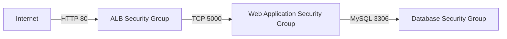

# Security Design

## 1. Overview

The Ritual Roast application uses multiple security controls to protect the load-balancing, application and database tiers.

The security design includes:

- Security groups that permit traffic only between authorized tiers
- Private placement of EC2 and RDS resources
- An IAM role attached to the EC2 instances
- AWS Systems Manager Session Manager for administrative access
- AWS Secrets Manager for database credentials
- Amazon S3 for application deployment artifacts

## 2. Security Group Design

Three security groups control traffic between the application tiers.

| Security group | Inbound port | Source | Purpose |
|---|---:|---|---|
| `ritual-roast-alb-sg` | TCP `80` | `0.0.0.0/0` | Allows public HTTP requests to the ALB |
| `ritual-roast-web-sg` | TCP `5000` | `ritual-roast-alb-sg` | Allows the ALB to reach the Flask application |
| `ritual-roast-db-sg` | TCP `3306` | `ritual-roast-web-sg` | Allows the application to connect to MySQL |

Security groups are used as rule sources between the tiers instead of fixed IP addresses.

## 3. Permitted Traffic Flow



The security-group configuration does not permit:

- Direct public access to the EC2 application instances
- Direct public access to the RDS database
- Direct communication between the ALB and the database
- SSH access from the internet
- Database access from unidentified IP addresses

## 4. EC2 IAM Role

The EC2 application instances use the following IAM role:

```text
ritual-roast-master-ec2-iam-role
```

The role combines the permissions required by the EC2 instances to communicate with AWS Systems Manager, Amazon S3 and AWS Secrets Manager.

### Trust relationship

The IAM role can be assumed by the Amazon EC2 service.

```json
{
  "Version": "2012-10-17",
  "Statement": [
    {
      "Effect": "Allow",
      "Principal": {
        "Service": "ec2.amazonaws.com"
      },
      "Action": "sts:AssumeRole"
    }
  ]
}
```

### Attached permissions

| Policy | Policy type | Purpose |
|---|---|---|
| `AmazonSSMManagedInstanceCore` | AWS managed | Enables Systems Manager management and Session Manager access |
| `AmazonS3FullAccess` | AWS managed | Allows EC2 to access application artifacts stored in Amazon S3 |
| `ritual-roast-rds-db-secret-policy` | Custom policy | Allows the application to retrieve the RDS database secret |

Only one IAM role is attached to the EC2 instance profile. That role contains all permissions required by the instance.

## 5. Systems Manager Access

The `AmazonSSMManagedInstanceCore` policy allows the private EC2 instances to register as AWS Systems Manager managed nodes.

Session Manager is used instead of public SSH access because:

- The EC2 instances do not require public IP addresses.
- Port `22` does not need to be opened.
- Administrative access is controlled through IAM.
- Session activity can be centrally governed and audited.
- Access does not require distributing SSH private keys.

The EC2 instances reach the Systems Manager service through the NAT Gateway.

## 6. Amazon S3 Access

The guided implementation attaches the following AWS-managed policy:

```text
AmazonS3FullAccess
```

The EC2 instances require S3 access to download the Flask application files during initialization.

### Security observation

`AmazonS3FullAccess` provides broader permissions than the application requires. It was used as part of the guided learning implementation.

A production implementation should replace this policy with a least-privilege policy that provides access only to the required application bucket.

An example least-privilege policy is shown below.

```json
{
  "Version": "2012-10-17",
  "Statement": [
    {
      "Sid": "ListApplicationBucket",
      "Effect": "Allow",
      "Action": "s3:ListBucket",
      "Resource": "arn:aws:s3:::APPLICATION_BUCKET_NAME"
    },
    {
      "Sid": "ReadApplicationArtifacts",
      "Effect": "Allow",
      "Action": "s3:GetObject",
      "Resource": "arn:aws:s3:::APPLICATION_BUCKET_NAME/*"
    }
  ]
}
```

`APPLICATION_BUCKET_NAME` must be replaced with the name of the Ritual Roast application-artifact bucket.

The policy should not permit the EC2 instances to access unrelated S3 buckets.

## 7. AWS Secrets Manager Access

The following custom policy allows the application to retrieve the RDS database credentials:

```text
ritual-roast-rds-db-secret-policy
```

The application requires this Secrets Manager action:

```text
secretsmanager:GetSecretValue
```

The policy should restrict access to the specific Ritual Roast database secret.

A least-privilege policy follows this structure:

```json
{
  "Version": "2012-10-17",
  "Statement": [
    {
      "Sid": "ReadRitualRoastDatabaseSecret",
      "Effect": "Allow",
      "Action": "secretsmanager:GetSecretValue",
      "Resource": "DATABASE_SECRET_ARN"
    }
  ]
}
```

`DATABASE_SECRET_ARN` represents the ARN of the Ritual Roast database secret.

The public documentation should not include the complete secret ARN if it exposes the AWS account ID or other unnecessary identifiers.

## 8. Database Credential Protection

Database credentials are stored in AWS Secrets Manager instead of being embedded directly in:

- Application source code
- EC2 user data
- GitHub documentation
- S3 object names
- Deployment instructions

The documentation and screenshots must never contain:

- Database passwords
- Secret values
- AWS access keys
- AWS secret access keys
- Temporary session tokens
- Complete AWS Console URLs containing the account ID

## 9. Security Boundaries

### Public boundary

Only the Application Load Balancer accepts application traffic from the internet.

### Application boundary

The EC2 application instances:

- Run in private Web subnets
- Do not require public IP addresses
- Accept port `5000` only from the ALB security group
- Use an IAM role to access AWS services
- Use Session Manager for administrative access

### Database boundary

The RDS database:

- Runs in private Data subnets
- Is configured as not publicly accessible
- Accepts port `3306` only from the Web security group
- Stores application data separately from the compute tier

## 10. Learning Implementation and Production Improvements

| Area | Learning implementation | Production improvement |
|---|---|---|
| S3 permissions | `AmazonS3FullAccess` | Restrict access to the application bucket and required actions |
| Server access | Systems Manager Session Manager | Retain and add centralized session logging |
| Database credentials | AWS Secrets Manager | Retain and configure controlled credential rotation |
| Public traffic | HTTP on port `80` | Configure HTTPS using AWS Certificate Manager |
| Application traffic | Port `5000` from the ALB security group | Retain security-group referencing |
| Database traffic | Port `3306` from the Web security group | Retain security-group referencing |
| Network protection | Security groups | Add AWS WAF and VPC Flow Logs |
| AWS service access | Through NAT Gateway | Add appropriate VPC endpoints |
| Permissions | Combination of broad and scoped policies | Apply least privilege to every policy |

## 11. Security Validation Checklist

### Security groups

- [x] ALB security group allows HTTP on port `80`
- [x] Web security group allows port `5000` only from the ALB security group
- [x] Database security group allows port `3306` only from the Web security group
- [x] No database rule permits access from `0.0.0.0/0`
- [x] No public SSH rule is configured

### IAM role

- [x] `ritual-roast-master-ec2-iam-role` exists
- [x] The role trusts the EC2 service
- [x] `AmazonSSMManagedInstanceCore` is attached
- [x] `AmazonS3FullAccess` is attached for the guided implementation
- [x] `ritual-roast-rds-db-secret-policy` is attached
- [ ] Confirm that the secret policy references only the required database secret
- [ ] Confirm that the launched EC2 instances appear as Systems Manager managed nodes

### Credential protection

- [ ] Confirm that RDS is not publicly accessible
- [ ] Confirm that database credentials are stored in Secrets Manager
- [ ] Confirm that secret values do not appear in EC2 user data
- [ ] Confirm that secret values are absent from GitHub
- [ ] Confirm that screenshots do not expose sensitive information

## 12. Evidence to Capture

Capture the following screenshots:

1. ALB security group inbound rules
2. Web security group inbound rules
3. Database security group inbound rules
4. EC2 IAM role summary
5. IAM policies attached to the EC2 role
6. Secrets Manager policy summary without displaying the secret value
7. EC2 instance visible as a Systems Manager managed node
